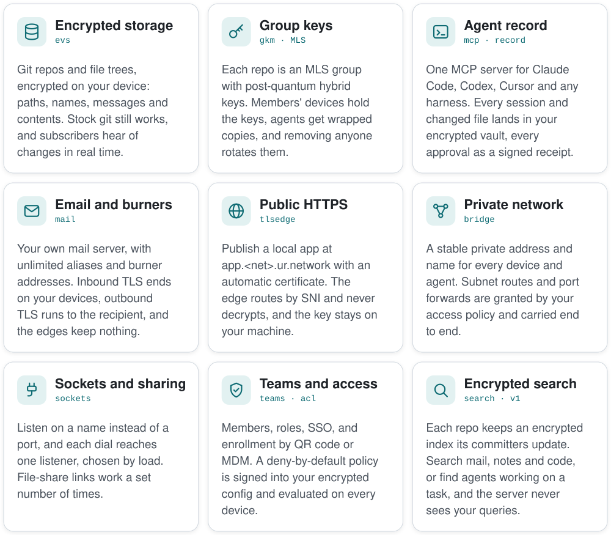
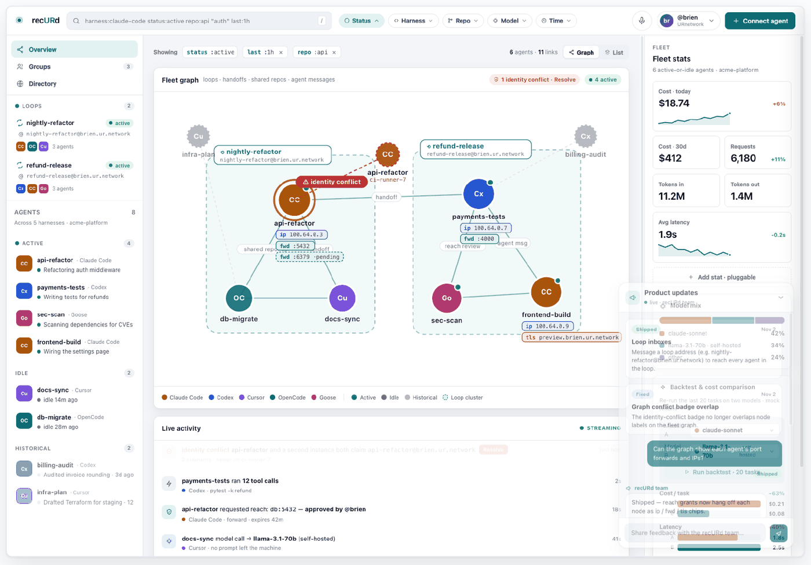
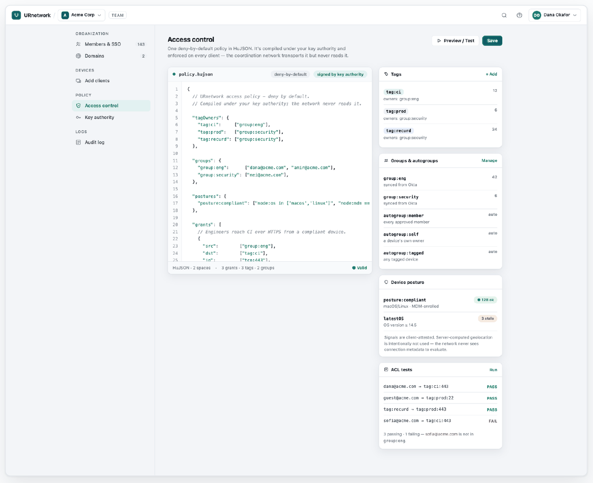
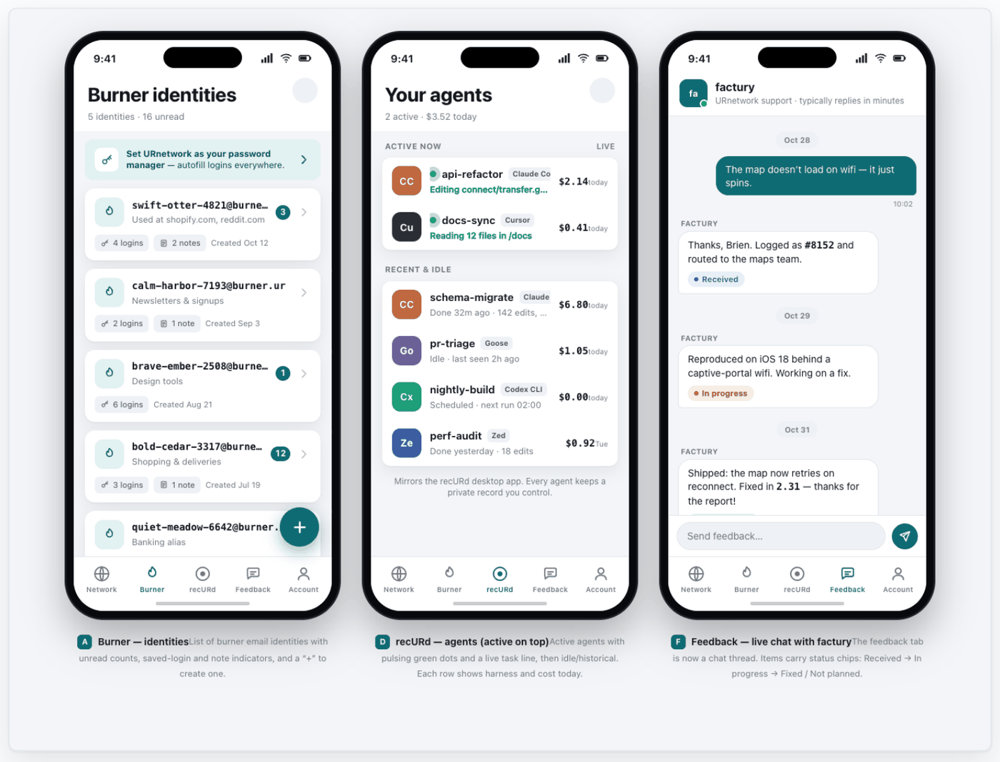

# sidecar

End-to-end encrypted infrastructure for agents, storage and mail. It runs on your devices and holds your keys; URnetwork's services see only ciphertext.

Design stage: nothing is implemented yet. The full design is in [DESIGN.md](DESIGN.md), and implementation starts from [HANDOFF.md](HANDOFF.md).

## Services

<picture>
  <source media="(prefers-color-scheme: dark)" srcset="design/readme/services-dark.svg">
  
</picture>

## End-to-end improvements

| | Usually | With sidecar |
|---|---|---|
| **Code and files** | The host can read contents, file names and commit messages. | Encrypted on your device, and stock git still works. |
| **Keys** | The provider holds the encryption keys. | MLS group keys; no server ever holds them in the clear. |
| **HTTPS to your apps** | The edge decrypts every request. | The edge routes by SNI, and TLS ends on your machine. |
| **IP and port forwarding** | Agents inherit their host's whole network reach through its VPN routes and port forwards. | With a policy in place, each route and port forward is a grant with an approver and an expiry, enforced where the traffic lands. Traffic stays end-to-end encrypted, one switch revokes an agent's reach, and receipts record each use. |
| **Email** | The mail provider handles your mail in the clear. | TLS runs between your devices and other mail servers, and the edges keep nothing. |
| **Access policy** | The control server holds the policy and the node keys. | Policy is signed into your encrypted config; servers enforce only ids. |
| **Admin access** | Admins can reach any member's data. | A member's vault and mailbox open only with that member's signed consent. |
| **Agent sessions** | Sessions are scattered across vendor apps, and checkpoints miss shell edits. | One encrypted vault per developer, with every edit and signed approvals. |
| **Search** | You download all your mail first, or the server sees your queries. | You download only the encrypted index, and queries stay on your network's devices. |

Our services still see sizes, timing and a few routing values, listed in [DESIGN.md Appendix G](DESIGN.md#appendix-g-server-visible-metadata-list). The cryptography is not yet audited.

## Apps built with sidecar

The previews below are design-stage mockups from [design/mocks/](design/mocks/).

**recURd:** the fleet graph of a developer's agents across harnesses.



**recURd team console:** a deny-by-default access policy, signed under the team's own keys.



**URnetwork app:** burner email identities, your agents, and feedback.



## Verifying a release of ur

Each release of `ur` publishes a `SHA256SUMS` over its packages and a `ur-release.json` naming its version and files. A release is installable by script once it is promoted: two people holding an offline Ed25519 key sign its `SHA256SUMS`, and ur.io serves the sums, the signature and the release's `ur-release.json` as `latest.json` (DESIGN.md §4.10).

The public key is published as `RELEASE-KEY.pub` at the top of this repository and at `https://ur.io/recurd/release-key.pub`: one line, `ssh-ed25519 <key> ur-release`. Signatures use the SSH signature format in the namespace `ur-release`, under the identity `ur-release`. To check a release by hand with OpenSSH 8.1 or later:

```sh
echo "ur-release namespaces=\"ur-release\" $(cut -d' ' -f1,2 RELEASE-KEY.pub)" > allowed_signers
ssh-keygen -Y verify -f allowed_signers -I ur-release -n ur-release -s SHA256SUMS.sig < SHA256SUMS
shasum -a 256 -c SHA256SUMS --ignore-missing
```

Neither file exists yet: the key is made at its ceremony, and until then nothing is promoted and `install.sh` refuses to install.

---

Licensed under [MPL-2.0](https://www.mozilla.org/en-US/MPL/2.0/).
